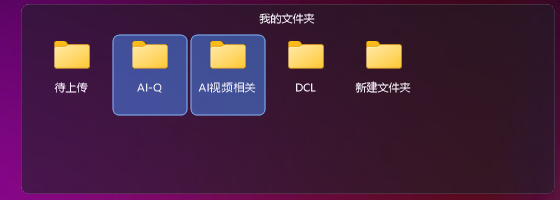
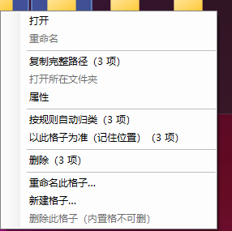

# 桌面整理 · 精简版（DeskLite）

对 **腾讯桌面整理 DeskGo 4.3.1809.127** 的轻量化复刻 —— 保留「格子 + 项 + 类型码」这套核心操作逻辑与规则，
界面样式按 **腾讯桌面管家** 的格子观感逐项校准。

功能范围收敛为 **5 个模块**：桌面整理 / 桌面搜索 / 设置 / 右键集成 / 支撑层。
技术形态为 **.NET 7 WinForms 原生应用**，接管真实桌面图标。

---

## 为什么写这个

腾讯桌面整理的格子确实好用，但它捆着魔镜壁纸、云盘、AI 问答、内嵌浏览器、更新与遥测一整套模块，
常驻 3 个进程、180 MB 内存。这个项目只留下「格子 + 按规则自动归类 + 桌面搜索」这三件每天真在用的事，
把常驻占用压到 **1 个进程、约 9 MB**。

| 对比项 | DeskLite | 腾讯桌面整理 |
|---|---:|---:|
| 进程数 | **1** | 3 |
| 内存（工作集） | **9.0 MB** | 181.7 MB |
| 私有内存 | **22.2 MB** | 276.8 MB |
| 空闲 CPU | **0.000%** | 0.126% |
| 句柄数 | **498** | 1680 |
| 产物体积 | **557 KB** | 100 MB+ |

> 数据为 2026-10 在本机（Windows，6 核）实测：30 秒稳态采样取均值，两者同时运行。
> 复现脚本与完整明细见 [九、资源占用与轻量化](#九资源占用与轻量化)。

## 界面

格子完全自绘（圆角、深色半透明、标题居中、标签两行省略），支持框选多选与批量操作：



右键菜单按「格子项」与「格子本体」分组，批量操作会带上选中数量：



应用图标（`Resources/app.ico`，9 档尺寸）：多尺寸预览见 [docs/icon-preview.png](docs/icon-preview.png)。

## 运行方式

**环境要求**

| 项目 | 要求 |
|---|---|
| 系统 | Windows 10 / 11（x64） |
| 运行时 | [.NET 7 Desktop Runtime](https://dotnet.microsoft.com/download/dotnet/7.0)（框架依赖模式，产物仅 557 KB） |
| 权限 | 普通用户即可，无需管理员 |

**从源码编译运行**

```bash
git clone https://github.com/q5210823/DeskLite.git
cd DeskLite
dotnet build -c Release
bin\Release\net7.0-windows\DeskLite.exe
```

启动后常驻托盘，默认接管桌面图标。想退出并还原桌面：托盘右键 →「退出并还原桌面」。

> 如果本机装了「腾讯桌面整理」，建议先退出它再启动本程序 —— 它的桌面覆盖层会盖住原生图标层，
> 导致两套格子叠加。详见 [六、与「腾讯桌面整理」的冲突](#六️与腾讯桌面整理的冲突重要)。

## 免责声明

- 本项目是**个人学习性质**的桌面整理工具实现，用于研究 Win32 桌面层接管、分层窗口渲染与图标提取等技术。
- 实现过程参考了公开可见的交互行为与界面观感，**不包含腾讯公司的任何代码、二进制文件、图标或美术资源**。
- 项目与腾讯公司及其产品（腾讯桌面整理 / 腾讯桌面管家）**无任何关联**，也未获得其授权或认可。
- 若权利人认为本项目存在不妥，请通过 Issue 联系，会及时处理。

## 目录

| 章节 | 内容 |
|---|---|
| [一、功能范围](#一功能范围) | 保留哪 5 个模块、砍掉了什么 |
| [二、界面样式](#二界面样式对齐腾讯桌面管家) | 逐项对齐表、格子交互、自动避让 |
| [三、保留的核心规则](#三保留的核心规则与原版一致) | 类型码、内置格子 ID、归类规则、序列化格式 |
| [四、设置中心](#四设置中心) | 基础页 / 桌面页 / 右键集成页 |
| [五、右键集成](#五右键集成) | 注册结构、菜单风格、命令转交 |
| [六、与「腾讯桌面整理」的冲突](#六️与腾讯桌面整理的冲突重要) | 覆盖层原理与正确用法 |
| [七、快速开始](#七快速开始) | 托盘操作一览 |
| [八、图标提取](#八图标提取踩坑记录) | 多级回退、高清管线、虚拟项 |
| [九、资源占用与轻量化](#九资源占用与轻量化) | 实测对比与为此做的 8 项设计 |
| [十、数据存储](#十数据存储) | 数据文件格式与备份策略 |
| [十一、诊断命令](#十一诊断命令排错用) | 排错用的 20+ 个自检命令 |
| [十二、工程结构](#十二工程结构) | 目录与模块划分 |
| [十三、已知限制](#十三已知限制) | 当前不支持的能力 |

---

## 一、功能范围

| 模块 | 内容 | 对应 DeskGo 组件 |
|---|---|---|
| **桌面整理** | 格子、按类型码自动归类、拖拽、折叠收展、变更监听、接管桌面图标 | `DesktopMgr64.exe` + `Features64.dll` |
| **桌面搜索** | 文件名子串 + 拼音首字母、全局热键唤起、右键菜单唤起 | `DesktopSearch64.exe` + `DiskSearchCore64.dll` |
| **设置** | 基础 / 桌面 / 右键集成 三页 | `DesktopSettings.exe` |
| **右键集成** | 桌面背景、文件/文件夹级联菜单；菜单风格切换（Win11 / 经典净化） | `DeskMgrShellExtx64.dll` + `Win11ContextMenu.exe` |
| **支撑层** | 数据持久化 + 日/周/月滚动备份、单实例、命令总线、冲突检测、图标缓存 | `QMIpc64.dll`、`QMLogEx64.dll` 等 |

**去掉的部分**：壁纸（魔镜壁纸 / 挂件 / 壁纸库）、云与 AI（一键上云 / AI 问答 / AI 便签 / IM）、
内容（内嵌 CEF 浏览器 / TBS / 下载中心），以及原版的更新、下载加速、自保护、遥测上报体系。

结果：产物只有 **数百 KB**（框架依赖模式），常驻内存约 **20 MB**（原版 DeskGo 常驻 100 MB+）。

---

## 二、界面样式（对齐腾讯桌面管家）

格子**完全自绘**（`UI/BoxView.cs`），不再使用 WinForms `ListView`。
原因：`ListView` 做不到「标题居中、无独立标题栏色块、格子尺寸贴合内容、标签两行省略」这些特征。

### 2.1 与参考图的逐项对齐

| 特征 | 实现 |
|---|---|
| 面板 | 圆角 8px、深色半透明、**1px 细描边**（`rgba(255,255,255,0.13)`），无阴影无渐变 |
| 标题 | **水平居中**，与内容同底色（没有独立标题栏色块）；悬停时才露出折叠箭头 |
| 图标 | 默认 **40px**，按 `CFG_ICON_SIZE` 可调 |
| 标签 | 图标下方居中，**最多两行**、顶对齐、超长自动省略号 |
| 网格 | 列宽 = 图标 + 38px，行高 = 图标 + 4 + 两行文字 + 8（图标 40px 时为 **78×80**） |
| 列数 | APP = **5 列**，我的文件夹 / 我的文件 / 系统 = **3 列**（与参考图一致） |
| 尺寸 | 格子**贴合内容**：宽由列数决定，高由行数决定；超过工作区 80% 才出现细滚动条 |
| 悬停/选中 | 极低透明度白色圆角块（10% / 15%），不抢图标视觉 |
| 文字渲染 | 用 GDI+ **灰度抗锯齿**而非 GDI ClearType —— 窗口带整体 alpha，ClearType 的次像素渲染会在字形边缘产生彩色毛边 |

> 度量值（图标 40px / 单元格 78×80 / 标签 8.5pt / 标题 9pt）都是从参考截图**实测像素**反推出来的，
> 不是目测调的。复现方式：`DeskLite.exe --uishot style-preview.png 40 92`

### 2.2 格子交互

| 操作 | 行为 |
|---|---|
| 拖标题栏 | 移动格子（位置持久化）；双击标题栏 = 折叠 / 展开 |
| **拖四角 / 四边** | **自由调整格子大小，图标自动重排（见 2.2.1）** |
| 单击 | 选中（`CFG_FENCES_DBLCLICK_OPEN` 关闭时改为单击打开） |
| 双击 | 打开该文件 / 文件夹 |
| 右键 | 打开 / 重命名 / 复制路径 / 打开所在文件夹 / 属性 / 按规则自动归类 / 以此格子为准 / 删除 |
| 右键（空白处） | 一键整理桌面 / 折叠展开 / **自动贴合内容**（仅在手工调过尺寸后出现） |
| F2 | 就地重命名（内嵌 `TextBox`，Enter 提交、Esc 取消，真正改文件名） |
| Delete | 移入回收站（`SHFileOperation` + `FOF_ALLOWUNDO`，可还原） |
| 滚轮 | 内容溢出时滚动（经 `WM_MOUSEWHEEL` 在窗口壳转发，格子未聚焦也能滚） |
| 拖到别的格子 | 手工改派（写入 `Flags=1` 的覆盖记录，优先于规则自动归类） |
| 从资源管理器拖入 | 不在桌面的先移到桌面，再归入该格子 |

#### 2.2.1 四角拉伸与图标自动重排

格子默认按内容「贴合适配」大小；鼠标移到四角 / 四边会出现调尺寸光标（↔ ↕ ⤡ ⤢），
拖拽即可自由改变大小，**格子内的图标会按新宽度自动重排成合适的列数**。

实现要点（`BoxView.Relayout`）：

```
列数 = max(1, (客户区宽 − 左右内边距) / 单元格宽)      ← 由实际宽度反推，上限 12 列
```

这个式子有个重要的自洽性质：**自动尺寸时**窗口宽度恰好等于
`2*pad + min(IdealColumns, 项数)*cellW`，反推回来仍等于 `min(IdealColumns, 项数)`
—— 与旧行为逐像素一致（`--resizetest` 里有回归校验）。
所以「按宽度反推」不会破坏原来的自动布局，只是让手工拉伸也能生效。

| 宽度 | 列数 | 说明 |
|---|---|---|
| 90–140 px | 1 | 极窄，图标竖排，内容超高时滚动 |
| 200 px | 2 | |
| 300 px | 3 | 与内置格子的默认列数一致 |
| 900 px | 11 | 拉得很宽也能自动铺开 |
| ≥ 940 px | 12 | 触到 `BoxView.MaxColumns` 上限 |

**用户尺寸会被记住**：拖完落盘 `DeskBox.ManualSize = true`（复用 `boxScreen` 第 11 个字段，
DeskGo 里该位恒为 0，可安全占用）。此后刷新 / 重启都不会再把尺寸改回「贴合内容」，
想回到自适应可用右键菜单的「自动贴合内容」。

**拖动过程中不会误选图标**：外壳层判定为拉边缘时置 `BoxView.SuppressMouse`，
视图收到后跳过命中测试与拖拽启动 —— 否则按住右下角会同时把那个图标选上。
光标也由视图统一决策（`BoxView.EdgeCursor`），因为它自己设置的 `Cursor` 跑在
外壳层之后，会把外壳层设置的光标覆盖掉。

#### 2.2.2 毛玻璃：只有底板透明，图标保持清晰

`CFG_SYS_GLASS` 调的**只是底板的不透明度**，图标与文字始终是「满格」显示 ——
把格子调到 40% 也不会让里面的图标跟着发灰。

这一点是刻意做出来的，因为「整窗一个 alpha」的做法做不到。两种实现的区别：

| | 旧：`Form.Opacity` | 新：`UpdateLayeredWindow` |
|---|---|---|
| 底层机制 | `SetLayeredWindowAttributes(LWA_ALPHA)` | 32bpp ARGB 位图逐像素提交 |
| alpha 粒度 | 整窗**一个常数** | **每个像素各自的 alpha** |
| 调透明度的后果 | 底板 + 图标 + 文字一起被同一个系数乘掉 | 只有底板变，图标文字不受影响 |

实测（格子内取样，`--alphaprobe`）：

| 玻璃 | 旧：底板亮度 / 图标亮度 | 新：底板亮度 / 图标亮度 |
|---|---|---|
| 100% | 20.0 / 255.0 | 20.0 / 255.0 |
| 67% | 16.0 / **178.7** ↓ 图标变淡 | 25.7 / **255.0** 不变 |
| 40% | 15.7 / **118.3** ↓ 更淡 | 32.0 / **255.0** 不变 |

看两件事：**① 底板亮度确实在变**（说明透明度生效，能透出壁纸）；
**② 图标亮度恒定 255**（说明图标完全不受透明度影响）。旧做法下图标亮度会一路掉到 118 —— 正是「图标跟着一起变淡」的现象。

渲染管线（`BoxForm.RenderLayered`）：

```
GDI+ 画到 32bpp ARGB 位图  →  LockBits 拷进 DIB section  →  UpdateLayeredWindow 提交
        （底板带 alpha）              （保留 alpha 通道）           （ULW_ALPHA + AC_SRC_ALPHA）
```

三个踩坑点，代码注释里也都标了：

1. **不能用 `Bitmap.GetHbitmap()`** —— 它产出的是 `Format32bppRgb`，**alpha 通道会被丢掉**，
   贴上去就是一张不透明的图，分层等于白做。必须自己 `CreateDIBSection` 再用
   `LockBits` + `RtlMoveMemory` 把 ARGB 原样搬进去。
2. **文字必须用 GDI+ 的 `DrawString`**，不能用 GDI 的 `TextRenderer` —— 后者不写 alpha 通道，
   文字周围会留下一圈不透明的底色块。
3. **`OnPaint` 里不能往窗口 DC 上画** —— 分层窗口的内容由 `UpdateLayeredWindow` 提交，
   子控件自己画的任何东西都会被丢弃。所以 `BoxView.OnPaint` 只负责触发渲染，
   真正的绘制搬到了 `PaintInto(Graphics)`。

另外两个连带改动：

- **圆角不再靠窗口 `Region`**：改成在 32bpp 位图里用 `SetClip` + 圆角路径裁出来
  （四角 alpha=0，天然平滑）。因为分层窗口自带「按 alpha 通道做命中测试」，
  再套一层 `Region` 等于裁两遍，部分系统上还会让分层内容整块不显示。
- **`EmbedInto` 的坐标系**：模型里存的是**屏幕坐标**，而子窗口的 `SetWindowPos`
  用的是**父窗口客户区坐标** —— Progman 的客户区原点并不在 `(0,0)`（本机实测 `(0,-678)`）。
  以前直接传屏幕坐标会把格子整体挪出屏幕，现在先取客户区原点再相减。
  `UpdateLayeredWindow` 的 `pptDst` 也有同样的坑（子窗口下按父客户区坐标解释），
  代码里没写死结论，而是每次提交后用 `GetWindowRect` 复核落点、自动修正偏移量，
  所以「顶层 ↔ 嵌入」来回切也能自愈。

### 2.3 自动避让

格子尺寸改为「贴合内容」后，旧布局数据可能让格子互相压住。
启动时会检测重叠，**仅在检测到重叠时**按「列优先、纵向堆叠、超出工作区高度就换列」重排一次；
没有重叠则完全尊重用户拖出来的位置。

---

## 三、保留的核心规则（与原版一致）

### 3.1 三要素

```
格子 Box  +  项 Item  +  类型码 Type
```

### 3.2 类型码定义

| 类型码 | 含义 |
|---|---|
| `1` | 文件夹 |
| `2` | 快捷方式 |
| `3` | 特殊项（此电脑 / 回收站 / 网络等） |
| `4` | 普通文件 |

### 3.3 内置格子 ID

| BoxID | 名称 |
|---|---|
| `1` | 系统 |
| `101` | 我的文件夹 |
| `102` | 我的文件 |
| `104` | APP |

> `1` 系统格子承载 **Shell 命名空间虚拟项**（此电脑 / 回收站 / 网络）。
> 它们没有文件路径，**枚举桌面目录永远看不到**，取用与取图标流程见 §8.3。
> 老数据文件里没有系统格子，启动时会自动补建一个 —— 并且刻意挑一个
> **与现有格子不相交**的位置，否则会触发 §2.3 的重叠重排，把用户拖好的布局冲掉。

### 3.4 自动归类规则

| 判定 | 结果 |
|---|---|
| 目录 | → `101` 我的文件夹 |
| `.lnk` 快捷方式 | → `104` APP |
| 特殊项 | → `1` 系统 |
| 可执行文件（`.exe/.msi/.bat/.cmd/.com/.ps1`） | → `104` APP |
| 其余普通文件 | → `102` 我的文件 |

> 「拖到别的格子」会产生 `Flags=1` 的手工覆盖记录，读取时**优先于**上表规则。

### 3.5 序列化格式（键名与原版对齐）

```
item[名称<|>BoxID<|>位置索引<|>类型码<|>完整路径<|>标志]
boxScreen[BoxID<|>名称<|>x<|>y<|>宽<|>高<|>…]
```

配置键沿用原版命名，便于对照与迁移：
`CFG_FENCES_CONFIGVERSION` / `CFG_FENCESBOX_COUNT` / `CFG_FENCESITEM_COUNT`

> 说明：原版 `FencesDataFile.dat` 是加密的（信息熵 7.985），本版用**相同结构的明文**存储，便于人工检查与排错。

### 3.6 其它行为

- 文件变更自动监听（900 ms 防抖），桌面增删改名后格子自动刷新
- 桌面搜索：文件名匹配 + **拼音首字母**匹配（如 `zds` → 找 `桌面搜索`）

---

## 四、设置中心

对应 DeskGo 的 `DesktopSettings.exe`（原版 3 页：基础 / 桌面 / 壁纸）。
精简版去掉壁纸页，拆出「右键集成」页，共 3 页。入口：**托盘右键 → 设置…**

设置保存到 `%APPDATA%\DeskLite\ConFile.dat`，采用与原版一致的 `CFG_*` 键名（纯文本，原版为加密的 OLE 复合文档）。

### 4.1 基础页

| 界面项 | 配置键 | 说明 |
|---|---|---|
| 外观主题 | `CFG_SYS_THEME` | 深色 / 浅色 |
| 格子毛玻璃 | `CFG_SYS_GLASS` | 30–100，格子不透明度（对应原版「毛玻璃效果配置」） |
| 图标大小 | `CFG_ICON_SIZE` | 32 / 40 / 48 / 64 像素（默认 **40**，与参考图一致） |
| 随 Windows 登录自动启动 | `CFG_DESKTOPMGR_AUTORUN` | 写 `HKCU\...\Run`（用户级，无需管理员） |

### 4.2 桌面页

| 界面项 | 配置键 | 说明 |
|---|---|---|
| 随 Windows 登录自动启动 | `CFG_DESKTOPMGR_AUTORUN` | 见下方「双保险」说明 |
| 启动后接管桌面图标 | `CFG_ENABLED_HIDE_ALL_ICONS` | 隐藏原生图标，由格子呈现 |
| 把格子嵌入桌面层 | `CFG_HIDE_ALL_FILESANDBOXES` | `SetParent` 到 `Progman`，随桌面显隐 |
| 记住格子的折叠状态 | `CFG_FENCES_AUTO_COLLAPSE` | 对应原版「格子自动收展配置」 |
| 桌面搜索快捷键 | `CFG_SEARCH_HOTKEY` | 形如 `Ctrl+Alt+S`，全局热键 |
| 双击打开项目 | `CFG_FENCES_DBLCLICK_OPEN` | 取消则改为单击打开 |

搜索快捷键在输入时会实时校验格式（`✓ 格式有效` / `✗ 格式无法识别`）；
保存后立即调 `RegisterHotKey` 生效，若被其他程序占用会在托盘弹提示。

#### 开机自启写两个位置（双保险）

`Core/Startup.cs` 同时维护两处，任一存在即算已登记，取消时两处一起清：

| 位置 | 路径 | 说明 |
|---|---|---|
| Run 键（首选） | `HKCU\...\CurrentVersion\Run` → `DeskLite` | 用户级权限，卸载删键完全回滚 |
| 启动文件夹（兜底） | `%APPDATA%\Microsoft\Windows\Start Menu\Programs\Startup\DeskLite.lnk` | 部分安全软件会静默清理 Run 键（本机实测出现过写入后条目消失），这个位置通常不被拦 |

两个容易踩的坑：

1. **用 `dotnet DeskLite.dll` 启动时** `Environment.ProcessPath` 是 `dotnet.exe`，
   直接登记会变成「开机启动一个空的 dotnet」。`Startup.ResolveExePath()` 会识别这种情况，
   换成同目录的 apphost（`DeskLite.exe`）。
2. **设置界面的勾选状态**取自 `_work.AutoRun || Startup.IsEnabled` —— 任一位置有效就显示为已勾选，
   避免用户或安全软件动过其中一个之后，勾选状态来回跳。

命令行也可以直接开关：`DeskLite.exe --startup on` / `--startup off`。

#### 格子位置会不会记住？—— 会，而且是拖完即存

```
标题栏拖拽松手 → BoxForm 把窗口坐标写回模型（_box.X / _box.Y）
              → 触发 onLayoutChanged 回调
              → MainContext: _store.Save(_data)
              → %APPDATA%\DeskLite\FencesDataFile.dat
                boxScreen[ID<|>名称<|>x<|>y<|>宽<|>高<|>…]
启动时        → BoxForm 构造里 Location = ClampToScreen(new Point(box.X, box.Y), Size)
```

实测往返（写入 300,200 / 800,300 / 1400,150 → 启动再退出）**一字不差**保留。
`ClampToScreen` 用 `Screen.FromPoint` 而不是主屏工作区，多显示器坐标也能正确还原。

会让「位置看起来没记住」的只有三种情况：

| 情况 | 说明 |
|---|---|
| **没开开机自启** | 重启后程序根本没启动，桌面自然是空的。勾上「随 Windows 登录自动启动」即可（写 `HKCU\...\Run`，用户级、无需管理员） |
| 格子重叠被重排 | 见 §2.3：**只有**矩形真的相交才整体重排一次。某个格子因桌面文件变多而长高、压到旁边格子时就会触发 |
| 位置跑到屏幕外 | `ClampToScreen` 会把它拉回工作区 |

> ⚠️ 这里踩过一个坑，值得记一笔：`ArrangeIfOverlapping()` **必须在格子内容灌好之后再调**。
> 早先在 `CreateBoxes()` 末尾调用，那时每个格子都还是 0 项，`MeasureContent` 量出来的是
> 「一行」的塌陷尺寸；拿它去判重叠会得出错误结论，而本函数又会 `_store.Save()` 把
> 重排结果写盘 —— 等于**永久**把用户拖好的布局抹掉，表现就是「位置又没记住」。
> 现在真正的调用点挪到了 `RefreshAll()` 末尾，并且只在首次灌入内容时执行一次
> （之后如果用户自己把格子叠在一起，那是他的选择，不该再被重排）。

> 补建系统格子（§3.3）时同样遵守这条：只挑**与现有格子不相交**的落点 ——
> 绝不因为补一个格子就触发整体重排、把用户拖好的布局冲掉。

### 4.3 右键集成页

见第五节。

---

## 五、右键集成

### 5.1 为什么不用 DeskGo 的方案

DeskGo 走的是**注入式 Shell 扩展 DLL**（`DeskMgrShellExtx64.dll`）：需要编译 COM 组件、管理员权限注册、
并加载进 `explorer.exe` 进程。体积大、有拖慢/拖崩资源管理器的风险。

精简版改用 **HKCU 注册表静态谓词（Verb）**：

- ✅ 无需管理员权限（只写当前用户）
- ✅ 无需编译 DLL、不注入 explorer，**零崩溃风险**
- ✅ 卸载即删键，可完全回滚
- ⚠️ 代价：Win11 上菜单出现在「显示更多选项」（`Shift+F10`）；如需回到经典菜单见 5.3

### 5.2 注册结构

以桌面背景为例：

```
HKCU\Software\Classes\DesktopBackground\Shell\DeskLite
    (默认)       = 桌面整理 · 精简版
    MUIVerb      = 桌面整理 · 精简版
    Icon         = "<exe>",0
    Position     = Bottom
    SubCommands  = ""            ← 空串表示使用 shell 子键下的级联项
    \shell\sort\command    (默认) = "<exe>" --cmd sort
    \shell\search\command  (默认) = "<exe>" --cmd search
```

三个作用范围：

| 范围 | 注册表路径 | 子菜单项 |
|---|---|---|
| 桌面空白处 | `...\DesktopBackground\Shell\DeskLite` | 一键整理桌面、桌面搜索 |
| 文件（任意类型） | `...\*\shell\DeskLite` | 一键整理桌面、桌面搜索、送入桌面格子 |
| 文件夹 | `...\Directory\shell\DeskLite` | 同上 |

### 5.3 菜单风格

| 设置项 | 配置键 | 行为 |
|---|---|---|
| Win11 新式菜单 | `CFG_RMENU_WIN11` | 删除 `HKCU\Software\Classes\CLSID\{86ca1aa0-…-50c905bae2a2}` |
| 恢复经典菜单（净化） | `CFG_RMENU_CLEAN` | 写入上述 CLSID 的空 `InprocServer32`，回到 Win10 经典菜单 |

切换后需**重启资源管理器**生效（设置页内置「重启资源管理器」按钮）。

### 5.4 命令转交机制

右键菜单注册的是「启动一个新进程」（如 `DeskLite.exe --cmd sort`），但主程序是**单实例常驻**的。
新进程启动后用 `RegisterWindowMessage` 注册的自定义消息 + `PostMessage(HWND_BROADCAST, …)` 广播给已运行实例；
带参数的 `sendto` 通过临时文件中转（广播无法跨进程传指针）。

| 命令 | 行为 |
|---|---|
| `--cmd sort` | 触发一键整理桌面 |
| `--cmd search` | 唤起桌面搜索窗 |
| `--cmd sendto "<path>"` | 把该文件/文件夹收入对应格子（不在桌面会先询问是否移动过来） |

---

## 六、⚠️ 与「腾讯桌面整理」的冲突（重要）

实测结论（已用像素级取证确认）：

| 层次 | 进程 | 窗口类 | 说明 |
|---|---|---|---|
| 覆盖层 | `DesktopMgr64.exe` | `TXMiniSkin` | `WS_POPUP` 顶层窗口，尺寸等于整个虚拟桌面，在其上**重绘格子 + 自己那份图标** |
| 原生层 | `explorer.exe` | `SysListView32` | 系统原生桌面图标层，被上面那层**完整盖住** |

**因此：DeskGo 在运行时，本程序隐藏原生图标虽然「实际已生效」，但画面上看不出变化，而且两套格子会叠在一起。**

### 正确用法

1. **退出腾讯桌面整理**（托盘图标右键 → 退出），确认进程列表中不再有 `DesktopMgr64.exe`
2. 启动 `DeskLite.exe`
3. 若仍检测到冲突：托盘右键 → **「重新检测桌面整理冲突」**

程序启动时会自动检测，检测到冲突则：托盘弹警告气泡、菜单顶部显示橙色冲突提示、
**不自动接管**（避免两套格子叠加）、手动点「接管桌面图标」时二次确认。

---

## 七、快速开始

```bash
# 编译
dotnet build -c Release

# 运行（默认启动即接管）
bin\Release\net7.0-windows\DeskLite.exe
```

运行后常驻**系统托盘**（图标「桌面整理 · 精简版」）：

| 托盘操作 | 作用 |
|---|---|
| 双击 | 打开桌面搜索 |
| 一键整理桌面 | 按规则重新扫描并分格 |
| 重新扫描 | 刷新格子内容 |
| 重新检测桌面整理冲突 | 重新探测 DeskGo 进程与覆盖层 |
| 接管桌面图标 | 隐藏 / 恢复原生图标 |
| 格子嵌入桌面层 | 把格子挂到 `Progman` 下 |
| 隐藏所有格子 | 一键收起 / 展开 |
| 桌面搜索… | 打开搜索窗 |
| **设置…** | 打开设置中心（基础页） |
| **右键菜单集成…** | 打开设置中心（右键集成页） |
| 打开数据目录 | 打开 `%APPDATA%\DeskLite` |
| 退出并还原桌面 | **退出前必调**：恢复原生图标，避免桌面图标一直隐藏 |

---

## 八、图标提取（踩坑记录）

桌面整理类软件最容易翻车的就是图标。本项目实测踩到三个坑，都已解决：

| # | 坑 | 现象 | 正解 |
|---|---|---|---|
| ① | `Icon.ToBitmap()` 丢 alpha | 透明区域被画成**纯黑方块** | 必须用 `DrawIconEx` 画到 `32bpp ARGB` 位图上 |
| ② | `SHGetFileInfo(SHGFI_ICON)` 对 `.lnk` 常返回空图标 | 一大批快捷方式（115浏览器 / Bandizip / Cheat Engine / ima / Edge / ReNamer…）**全黑** | 改用 `SHGFI_SYSICONINDEX` + `SHGetImageList` 走**系统 Imagelist** 取图 |
| ③ | 用假路径探测图标 | 拿不到程序专属图标，只有通用类型图标 | 文件/目录**存在时用真实路径**，只有路径不存在才退化到 `SHGFI_USEFILEATTRIBUTES` |
| ④ | **`DrawIconEx` 直接缩放**（本轮修复） | 256 → 40 的大幅缩小走 GDI 老缩放路径（不做低通滤波），边缘**锯齿 / 像素化** | 改为「原样渲染 + GDI+ 高质量缩放」两段式（见 8.2） |
| ⑤ | **无脑优先 Jumbo(256)**（本轮修复） | 少数图标在 256 档里是「大画布 + 角落小图」（Cheat Engine 3%、MyLauncher 4%），缩到 40px 后只剩**角落里一个看不清的小点** | 按「有效内容占比」给各档打分，取最合适的一档（见 8.2） |
| ⑥ | **1:1 贴图仍走双三次**（本轮修复） | 缓存的位图尺寸本来就等于目标尺寸，却因为 `DrawImage(rect)` + `HighQualityBicubic` 又被重采样一遍，**边缘发虚** | 尺寸相同直接 `DrawImageUnscaled`（零重采样） |

### 8.1 多级回退

最终实现为**多级回退 + 黑图检测**（`UI/IconCache.cs`）：

```
系统 Imagelist（Jumbo 256 / ExtraLarge 48 / Large 32，三档择优）
      ↓ 拿到黑图 / 失败
SHGetFileInfo(SHGFI_ICON) 原样渲染
      ↓ 拿到黑图 / 失败
按扩展名取通用图标
      ↓ 拿到黑图 / 失败
手绘中性占位图（保证永不出现黑方块）
```

### 8.2 高清管线

把「取像素」和「缩放」彻底拆开，缩放自己做、不交给 GDI：

```
① 原样渲染：DrawIconEx 的 cx/cy 传 HICON 内部位图的真实尺寸（1:1），不缩放
             → 拿到未经污染的原始像素（含 alpha）
② 纯字节级面积平均（area / box filter）：预乘 alpha 空间做加权平均再还原。
             缩小场景下它才是真正的低通滤波，不像双三次那样在细线边缘产生振铃 / 过冲。
③ 畸形资源修正：若有效内容贴住左上角 **且** 面积占比 ≤ 50%（典型的「图形被画在大画布
             角落」，如 Cheat Engine / MyLauncher），按内容包围盒裁出后重新铺满。
```

**按需取档、命中即停**（关键修复）：不再把三档全部渲染出来再评分，而是从最合适的一档
开始试，达标就停：

- 目标 ≤ 48 px 时以 ExtraLarge(48) 打头 —— 对 40 的目标既是「不小于目标」又是「最小的
  那一档」，一次渲染命中，**完全不碰 256 档**；目标 > 48 时才按大→小找；
- 达标判据：`HICON 真实像素 ≥ 目标` **且** `内容占比 ≥ 30%` **且** 非畸形资源。

`--iconprobe [txt]` 会逐项打印「三档的 HICON 真实像素尺寸 / 内容占比」，并输出
`iconprobe.png` 对照表（旧算法 vs 新算法 vs 三档原样渲染）。

**实测结论**：58 个桌面项里只有 2 项（Cheat Engine、MyLauncher）在 256 档里是 3% / 4% 的
「角落小图」，其余全部 ≥ 55% —— 这正是用户看到的「两个图标非常的小」的根因。

#### ⚠️ 畸形判据别写成「只看贴边」

第一版把达标条件写成 `!IsCornerClipped(box, bmp)`，而 `IsCornerClipped` 的门槛是
`box.Left <= 画布宽 / 8` —— 图标本来就会铺到画布边缘附近，于是**八成以上的正常图标被判成
畸形**，48 档永不达标，每个图标一路掉到 256 档再回来：

| | 旧判据（只看贴边） | 现判据（贴边 **且** 占比 ≤ 50%） |
|---|---|---|
| 每图标平均渲染次数 | 2.60 次 | **1.00 次** |
| 48 档达标率 | 14 / 58 | **58 / 58** |
| 256×256 档渲染次数 | 49 次 | **0 次** |
| `CopyExact` 复制位图 | 49 张 | **0 张** |

判据必须和 `Normalize` 的触发条件一致：**「贴住左上角」和「图形只占一小块」要同时成立**
才算畸形容器。修好后 `灌入格子` 阶段的内存增量从 +14.5 MB 降到 +3.8 MB。

排查方法：`--memstep` 输出里有一行「图标管线统计」，直接给出渲染次数、达标率、
各位图分配点的尺寸直方图。**光看内存总量是找不到这个 bug 的 —— 真正 new 出来的位图
合计只有 1.0 MB，而常驻涨了 14.5 MB；是「渲染/取图标被多做了 2.6 倍」而不是「位图太大」。**

### 8.3 虚拟项（此电脑 / 回收站 / 网络）的取用与取图标

**问题**：这几项由 explorer 的命名空间扩展提供，**没有文件系统实体**。
而格子的数据源是「枚举 `%USERPROFILE%\Desktop` + `%PUBLIC%\Desktop`」，
于是它们永远不会出现 —— 实测原生桌面 ListView 有 **60** 项、目录枚举只有 **58** 项，
差的就是「此电脑」和「回收站」。接管桌面后原生图标层被隐藏，用户看到的就是「这两项丢了」。

**补入流程**（`DesktopScanner.AppendVirtualItems`）：

```
① 目录枚举得到真实项（本机 58 项）
② 读 explorer 的 SysListView32 拿到全部图标项（本机 60 项）—— 含虚拟项
③ 按 VirtualItem 表用**显示名**匹配（「此电脑 / 计算机 / This PC」都算别名），
   命中且不与真实项重名 → 追加一条伪路径 ::{CLSID} 的记录
④ 只补「当前确实显示在桌面上」的项：ListView 里没有，就说明用户在
   「桌面设置 → 桌面图标」里把它关掉了 → 不补，尊重用户选择
```

伪路径约定 `::{CLSID}`：`Rules` 判为 `ItemType.Special` → 落进 `1` 系统格子；
打开时交给 `explorer.exe shell:::{CLSID}`；重命名 / 删除 / 定位一律置灰（没有实体可操作）。

#### ⚠️ 千万别用原生 ListView 的图标索引去取图标

第一版图省事，直接把 ListView 的 `LVIF_IMAGE` 索引拿去查 `SHGetImageList` —— **图标全错**：
「此电脑」渲染成了硬盘、「回收站」渲染成了带叉的驱动器。原因：**那不是同一张表**。
交叉验证 8 个真实项：

| 显示名 | ListView 索引 | SHGetFileInfo 索引 | |
|---|---|---|---|
| 01 | 11 | 51 | ✗ |
| Google Chrome | 12 | 93 | ✗ |
| 02 | 13 | 139 | ✗ |
| 04 | 15 | 139 | ✗ |
| AI-Q | 17 | 3 | ✗ |
| Cheat Engine | 18 | 227 | ✗ |

ListView 给的是 11/12/13/14… 这种**连续序号**（它自己私有 Imagelist 的槽位），
而系统 Imagelist 的索引是 51/93/139/226… —— 抽查 8 项，**0 项一致**。

正确做法是走 Shell 官方路径（`IconCache.ShellIconIndexByParsingName`）：

```
"::{20D04FE0-3AEA-1069-A2D8-08002B30309D}"
  → SHParseDisplayName                                   得到 PIDL
  → SHGetFileInfo(SHGFI_PIDL | SHGFI_SYSICONINDEX)       拿到**系统** Imagelist 索引
  → 之后完全复用 §8.2 的管线（按需取档 → 畸形修正 → 面积平均缩放）
回退：SHGetFileInfo(SHGFI_PIDL | SHGFI_ICON) 直接给 HICON
```

> 教训：**跨进程读到的「索引」不一定属于你以为的那张表。** 这类问题光看代码看不出来，
> 必须找一个「两条路都能取到」的样本做交叉验证 —— 这里就是拿真实桌面项当基准，
> 一比就露馅了。

`--virtest [png] [尺寸]` 会跑完整链路并输出：目录枚举项数、ListView 项数、补入项数、
上面那张交叉验证表、取图标溯源，以及一张 4× 对照图。

---

## 九、资源占用与轻量化

### 9.1 与「腾讯桌面整理」的实测对比

同一台机器、同一时间段、同口径采样 20 秒：

| 指标 | 腾讯桌面整理 4.3.1809.127 | DeskLite | 倍数 |
|---|---|---|---|
| 进程数 | 3（DesktopMgr64 / DesktopService64 / DesktopAITaskCenter） | **1** | — |
| 常驻内存 · 工作集 | 45.2 MB | **21.5 MB** | 1 / 2.1 |
| 私有内存（真实成本） | 242.9 MB | **22.1 MB** | **1 / 11** |
| 线程数 | 124 | **15** | 1 / 8.3 |
| 句柄数 | 1 872 | **528** | 1 / 3.5 |
| GDI 对象 | — | 78 | — |
| USER 对象 | — | 41 | — |
| 空闲 CPU | 0.094 s / 20 s ＝ **0.47 %**（占单核） | 0.047 s / 20 s ＝ **0.23 %**（占单核） | 1 / 2 |
| 磁盘占用 | 704 MB（安装目录，含 CEF / TBS / 云 / AI） | **377 KB**（发布产物 4 个文件） | 1 / 1900 |
| 启动初始化耗时 | — | ≈ 0.8 s（含建格子 + 接管 + 装监听 + 取 58 个图标） | — |

两组读数都是**同一台机器、同一时间段、同一个 20 秒采样窗口**。工作集取「空闲 20 秒」的稳态值
（刚做完内存整理时的瞬时值会显著更低，但那不是稳态）。对照组是三个常驻进程的合计值。

**私有内存的累计优化轨迹**：

| 阶段 | 私有内存 | 线程 | 句柄 |
|---|---|---|---|
| 最初基线 | 39.6 MB | 27 | 659 |
| 上一轮末（图标清晰度修复 + GC 调优 + 拼音表内联） | 33.0 MB | 16 | 531 |
| **本轮（图标档位判据修复）** | **22.1 MB** | **15** | **528** |

累计 −44 %。其中本轮贡献 −11.2 MB，全部来自「不再对每个图标多渲染 2.6 倍的位图」。

### 9.2 为此做的轻量化设计

| 手段 | 说明 |
|---|---|
| 框架依赖发布 | `SelfContained=false`，产物仅 4 个文件约 377 KB，复用系统 .NET 运行时 |
| `InvariantGlobalization` | 不加载 ICU 全球化数据（本程序不做区域相关排序/格式化；汉字→拼音走 GB2312 码表，与 ICU 无关） |
| `EventSourceSupport=false` | 关掉事件通道，少一组常驻元数据 |
| 启动后一次性内存整理 | 首屏渲染完成 2 秒后：强制 GC ×2 + `SetProcessWorkingSetSize(-1,-1)` 把闲置物理页交还系统。**整个运行期只做一次**（反复 trim 会让热页面反复换入换出，反而拖慢） |
| 保活巡检自适应退避 | 刚接管 / 刚被打回 → 800 ms；连续 20 次无事 → 退到 3000 ms。一次巡检只有 2 个 API 调用、零分配 |
| 图标 1:1 直贴 | `DrawImageUnscaled` 代替带目标矩形的 `DrawImage`，省掉每帧每图一次 GDI+ 重采样 |
| 图标按需取档、命中即停 | 只渲染「真用得上的那一档」，详见 8.2。**这一项单独贡献 −11.2 MB** |
| 中间位图复用池 | HICON → 位图 的中间图按尺寸复用（`Rent`/`Retire`），同一尺寸只分配一次；58 项下来 GDI+ 私有堆不再一路涨到高水位 |
| 像素扫描走 `LockBits` + `Marshal.Copy` | 内容包围盒 / 黑图检测不再逐点 `GetPixel`（快约两个数量级），且扫描缓冲每线程只分配一块、只增不减 |
| 拼音表内联为纯文本常量 | 去掉 `System.Text.Encoding.CodePages` 依赖（省 5.5 MB 的托管堆 + 程序集），汉字→首字母走内联的 GB2312 码位表 |
| GC 调优 | `System.GC.ConserveMemory=9` + 关闭并发 GC + `RetainVM=false` |
| 不做全盘索引 / 无 CEF / 无云模块 | 对应原版的 `DiskSearchCore64.dll`、CEF 内核、TBS、云与 AI 全部去掉 |

#### 还剩多少空间？—— 已经贴到「取系统图标」的地板

用 `DESKLITE_ICONSTUB` / `DESKLITE_ICONSTUB2` 两个开关做二分（见 11 节的开关表）：

| 配置 | 私有内存 |
|---|---|
| 完全不碰 shell 与 GDI+（只用手绘占位图） | 18.6 MB |
| 只走 shell 取图标、不做任何位图处理 | 21.7 MB |
| 当前完整流程 | 21.7 ~ 22.1 MB |

也就是说：**位图处理只剩 0.2 MB，剩下约 3 MB 全是 shell 自身的取图标机制**。
58 项里只有 44 个不同图标索引，按索引记忆化最多再省 ~0.7 MB —— 小于本机测量噪声（±0.5 MB），
不值得为此引入「多个路径共享同一张位图」的析构风险。再要明显降幅只能靠「图标结果落盘缓存」
跨会话复用，但那会改变首次启动的语义、省下的又是 shell 本该为资源管理器缓存的部分，
收益与代价不成比例，**不建议做**。

设置页「基础」页底部有**运行占用实时显示 + 「释放内存」按钮**，可随时手动触发同一套整理。

`--mem [秒] [txt]` 输出完整自检：启动 3 秒、整理后 1.5 秒、再空闲 N 秒三组读数 + 空闲期 CPU 占用。

---

## 十、数据存储

```
%APPDATA%\DeskLite\
├── FencesDataFile.dat               # 格子布局主数据（明文，键名对齐原版）
├── FencesDataFile.dat.tmp           # 原子写入的中间文件
├── FencesDataFile.dat_temp_YYYYMMDD # 8 份滚动日备
├── FencesDataFile_week              # 周备（每周一写）
├── FencesDataFile_month             # 月备（每月 1 日写）
└── ConFile.dat                      # 设置（CFG_* 键，纯文本）
```

布局写入采用 **临时文件 → 原子改名**，避免异常退出导致配置损坏；备份策略与原版一致。

> 调试小技巧：设置环境变量 `DESKLITE_CONFILE` 可指定备用设置文件路径，
> 用于演示 / 回归测试，不污染真实配置。

---

## 十一、诊断命令（排错用）

| 命令 | 作用 |
|---|---|
| `--uishot <png> [图标px] [玻璃%] [light]` | **样式预览**：把各格子离屏渲染并合成到真实壁纸上，不受前台窗口遮挡，用于核对界面样式 |
| `--layout` | 打印格子模型坐标 vs 窗口实际屏幕坐标（排查 DPI 缩放 / 定位偏差） |
| `--probe` | 环境与桌面窗口链探测 |
| `--listwnd` | 枚举桌面相关窗口树 |
| `--pointtest` | 用 `WindowFromPoint` 判定桌面图标像素归属哪个进程 |
| `--overlaytest <前缀>` | 临时隐藏覆盖层 + 原生层并逐帧截图（可逆），定位"隐藏无效"的原因 |
| `--hidetest` | 逐种隐藏方式实测哪种在当前系统生效 |
| `--conflict` | 冲突检测自检（DeskGo 进程 + 覆盖层） |
| `--shot <文件>` | 纯截图，不改动桌面 |
| `--fixdesktop` | 把桌面 ListView 复位到 Progman 位置（误操作后急救） |
| `--demo <png> <秒>` | 演示模式：建格子 → 截图 → 还原 → 退出 |
| `--icontest <png>` | 图标提取三方式对照表（A=旧 ToBitmap / B=DrawIconEx / C=Imagelist） |
| `--iconprobe [txt]` | **图标像素级诊断**：逐项打印三档 Imagelist 的 HICON 真实像素尺寸 + 内容占比，并输出 `iconprobe.png`（旧算法 / 新算法 / 三档原样渲染 并排） |
| `--mem [秒] [txt]` | **资源占用自检**：启动 3s / 整理后 / 再空闲 N 秒三组读数（工作集、私有、提交、峰值、线程、句柄、GDI、USER）+ 空闲期 CPU 占比 |
| `--memstep [txt]` | **构造过程逐步差分**：`MainContext` 构造 + 首屏绘制的每个节点各记一次快照，并对比相邻节点「新增/变大了哪些私有内存块」（含零填充采样，区分「未触碰的预留」与「已实际使用」）。末尾附「图标管线统计」 |
| `--memdiff [txt]` | 分阶段差分（runtime 基线 → WinForms 初始化 → 建格子 → 内存整理），用来回答「这些私有内存到底是谁的」 |
| `--virtest [png] [尺寸]` | **虚拟项自检**：验证 此电脑 / 回收站 / 网络 是否被认出、取图标是否走对路径。输出目录枚举项数、ListView 项数、补入项数、索引交叉验证表、取图标溯源，并导出 4× 对照图（默认 96 px） |
| `--resizetest` | **拉伸自检**：① 回归 —— 自动尺寸反推出的列数必须等于旧的固定列数 `min(IdealColumns, 项数)`；② 新行为 —— 宽度 90→1400 时列数跟随、图标不溢出可视区 |
| `--startup [on\|off]` | 开关开机自启，并回报 Run 键 / 启动文件夹两处状态与实际登记的目标 exe |
| `--glasstest [目录]` | **透明度诊断（近似环境）**：同一格子在「顶层窗口」与「嵌入 Progman」两种状态下用 1.00/0.67/0.35 三档 `Form.Opacity` 显示并抓屏，同时打印 `WS_EX_LAYERED` 标志位与 `SetLayeredWindowAttributes` 返回值 |
| `--glassfull [目录]` | **透明度诊断（完整路径）**：走 `MainContext` 真实启动（接管 + 嵌入），逐档改玻璃不透明度并全屏截图 —— 测的是用户实际看到的场景 |
| `--alphaprobe [目录]` | **逐像素 alpha 自检**：真实运行下逐档改玻璃，直接对格子矩形取样，对比「底板亮度变化 / 图标亮度波动」，并顺带验证分层窗口里就地改名的 `TextBox` 能否正常绘出。跑 `DESKLITE_NOLAYER=1` 可切回旧的整窗 alpha 做 A/B 对照 |
| `--settingsshot <png> [页]` | 设置界面截图（0 基础 / 1 桌面 / 2 右键集成） |
| `--settingstest` | 设置模块自检（键值、序列化往返、热键解析、自启状态） |
| `--shelltest` | 右键集成状态查询（只读） |
| `--shellinstall` / `--shelluninstall` | 按当前设置写入 / 移除右键菜单注册表项 |
| `--shellverify` | 右键集成「安装 → 验证 → 回滚」闭环自检（零残留） |
| `--cmd sort\|search\|sendto` | 供右键菜单调用，转交给已运行实例 |

### 11.1 定位内存开销用的环境变量开关

这些都是**排错用的**，默认关闭，只在配合 `--memstep` 做对照实验时才需要打开。
用法：`set DESKLITE_NOGFX=1 && DeskLite.exe --memstep out.txt`

| 开关 | 作用 |
|---|---|
| `DESKLITE_ICONSTUB=1` | 完全不碰 shell 与 GDI+，只给手绘占位图（量「地板」） |
| `DESKLITE_ICONSTUB2=1` | 走完 shell 取图标流程，但跳过 GDI+ 的渲染 / 扫描 / 缩放 |
| `DESKLITE_ICONREALN=N` | 只对前 N 项做真实提取，其余手绘（判断开销是「每项累积」还是「一次性初始化」） |
| `DESKLITE_NOGFX=1` | 只 `Rent` 位图，连 `Graphics.FromImage` 都不建 |
| `DESKLITE_NODRAWICON=1` | 建了 Graphics 但不调 `DrawIconEx` |
| `DESKLITE_NOLOCK=1` | 跳过 `LockBits` 像素扫描（内容包围盒 / 黑图检测） |
| `DESKLITE_NONORMALIZE=1` | 跳过 `Normalize` |
| `DESKLITE_NOSCALE=1` | 跳过 `Scale`（返回独立副本，保持「每图标一张缓存位图」的结构） |
| `DESKLITE_NOPOOL=1` | 关掉 GDI+ 中间位图复用池 |
| `DESKLITE_NOICON` / `NOTEXT` / `NOFILL` / `NOOPACITY` | 分别跳过 `BoxView.DrawCell` 的图标段 / 文字段 / 面板填充，以及 `BoxForm` 的窗体透明度 |
| `DESKLITE_NOLAYER=1` | **回退到旧的整窗 `Form.Opacity`**（关掉逐像素 alpha）。用于 `: ① 对照实验（见 11.2）；② 万一某台机器上分层窗口有兼容性问题，可紧急回退 |
| `DESKLITE_TRACE_ULW=1` | 打印每次 `UpdateLayeredWindow` 的坐标往返（期望落点 / 实际落点 / 坐标系修正量），排查「格子被挪走」 |
| `DESKLITE_CONFILE=<路径>` | 指定备用设置文件（演示 / 回归测试用，见第十节） |

绘制路径（`BoxView` / `BoxForm`）另有一套子步骤埋点，由 `MainContext` 的 `onStep` 回调统一
接到 `BoxView.Trace` 上，`--memstep` 里以 `~` 前缀输出、变化 < 64 KB 自动跳过。

### 11.2 透明度 A/B 对照实验

用 `--alphaprobe` 可以一键复现「旧做法 vs 新做法」的差别：

```bat
:: 新：逐像素 alpha
DeskLite.exe --alphaprobe out-new

:: 旧：整窗 alpha（对照）
set DESKLITE_NOLAYER=1
DeskLite.exe --alphaprobe out-old
```

取样口径：只取格子矩形内部，`底板色 = 亮度中位数`（格子面积以底板为主），
`图标/文字 = 亮度 99.5 分位`（图标高光与白字是最亮的那批像素）。

判定：底板亮度随档位明显变化 = 透明度生效；图标亮度几档之间不动 = 图标不受影响。

> **方法沉淀**：这次能定性，靠的不是「看截图觉得淡了」，而是**把主观感受变成两个可比较的标量**。
> 一开始我先怀疑是渲染被跳过、位图没提交，但 `--alphaprobe` 的取样表直接否掉了
> —— 底板亮度确实在变，说明链路是通的。真正的分叉点在「alpha 是整窗一个还是逐像素一个」，
> 这个结论只有把图标和底板**分开**测量才拿得到。
> 所以：`UpdateLayeredWindow` 是否成功要看 `GetLastError`，而「透明度对不对」要看
> 底板/图标两条亮度曲线的**相对变化** —— 两者缺一不可。

> 经验：**光看内存总量找不到这类 bug。** 本轮一开始以为「11 MB 来自位图分配」，
> 加了尺寸直方图才发现真正 new 出来的位图合计只有 1.0 MB —— 真正的开销是
> 「同一个图标被多渲染了 2.6 倍」。先做「谁在分配」的归因，再谈优化。

---

## 十二、工程结构

```
DeskLite/
├── Core/
│   ├── Model.cs            # ItemType / BoxIds / 分隔符 / DeskItem / DeskBox 序列化
│   ├── Rules.cs            # 归类规则引擎（类型码判定 → BoxID 映射）
│   ├── DeskData.cs         # 数据模型：默认格子、增删项、手工指派覆盖、重建索引
│   ├── DataStore.cs        # 布局持久化 + 原子写入 + 日/周/月备份
│   ├── Settings.cs         # 设置模型 + ConFile.dat 读写（CFG_* 键对齐）
│   ├── Startup.cs          # 开机自启（HKCU\...\Run）
│   ├── ShellIntegration.cs # 右键集成：注册表谓词安装/卸载/状态
│   ├── CmdBus.cs           # 命令总线（自定义消息广播）+ 全局热键
│   ├── DesktopScanner.cs   # 扫描用户桌面 + 公共桌面；补入 Shell 虚拟项
│   ├── VirtualItems.cs     # 桌面虚拟项表（此电脑 / 回收站 / 网络）：CLSID、别名、伪路径
│   ├── Pinyin.cs           # 汉字 → 拼音首字母（GB2312 区位码查表）
│   └── Conflict.cs         # DeskGo 冲突探测（进程 + TXMiniSkin 覆盖层）
├── Win32/
│   ├── Native.cs           # P/Invoke：ListView 跨进程读取、SHFileOperation、热键、壁纸等
│   └── DesktopHost.cs      # 桌面窗口链定位、图标枚举、隐藏/恢复、保活
├── UI/
│   ├── BoxView.cs          # ★ 格子内容视图（完全自绘：面板 / 标题 / 图标网格 / 交互）
│   ├── BoxForm.cs          # 格子窗口壳（圆角 Region、拖动、折叠、右键菜单、尺寸贴合）
│   ├── IconCache.cs        # 系统图标缓存（高清管线：原样渲染 + 高质量缩放 + 档位择优）
│   ├── SearchForm.cs       # 桌面搜索窗
│   ├── SettingsForm.cs     # 设置中心（3 页）
│   └── MainContext.cs      # 托盘主控制器
├── Program.cs              # 入口 + 诊断命令
├── app.manifest            # asInvoker 权限
└── DeskLite.csproj
```

---

## 十三、已知限制

1. **必须与 DeskGo 二选一**（见第六节）。这是 DeskGo 覆盖层机制决定的，非本程序缺陷。
2. 框架依赖模式发布，目标机需有 **.NET 7 桌面运行时**（`Microsoft.WindowsDesktop.App`）。
   需要免安装可改用 `-p:SelfContained=true` 自行发布。
3. 多显示器：窗口链按主屏 `Progman` 处理，格子可跨屏摆放但暂未做「按屏分格」。
4. 第 3 类「特殊项」（此电脑 / 回收站 / 网络）没有文件路径，只能从原生桌面 ListView
   按**显示名**匹配后补入（见 §8.3）。因此**只补「当前显示在桌面上」的项** ——
   如果这三项在「桌面设置 → 桌面图标」里被关掉了，格子里也不会出现，这是有意为之。
   取图标走 `SHParseDisplayName` + `SHGetFileInfo(SHGFI_PIDL)`，是 Shell 官方路径，不是近似实现。
5. 右键菜单为注册表静态谓词，Win11 上位于「显示更多选项」。
   要做到一级菜单需要实现 `IExplorerCommand` COM 接口，与「轻量化」目标冲突，故未采用。
6. 桌面搜索范围为**桌面目录**（用户桌面 + 公共桌面），不含全盘索引（原版的 `DiskSearchCore64.dll` 全盘索引已去掉）。
7. 格子**不支持手动拖边改尺寸**：尺寸由内容决定（列数固定、行数随项数），这是为了贴合参考图的外观；
   需要改列数或图标大小请到设置页调整。
8. 浅色主题在半透明 + 深色壁纸下会略显灰浊，属整体 alpha 的固有现象；
   把「格子毛玻璃」调到 90 以上即可获得干净的浅色面板。
9. 「启动后内存整理」会把工作集立刻压到 7 MB 左右，代价是**首次交互多几次页错误**
   （毫秒级，肉眼无感）；空闲一段时间后工作集会自然回到 14 MB 上下。
   峰值工作集仍是 107 MB —— 那是启动阶段 JIT + 首次渲染的真实高水位，报表里如实列出。
10. 图标默认 40 px：系统 Imagelist 没有 40 这一档，因此是 48 → 40 的高质量缩小（保真度最高）。
    若追求**零重采样**的极致锐利，把「图标大小」设为 **48** 即为 1:1 原样贴图。
11. 少数应用的图标资源本身就没做大尺寸（只有 16/32 档），这类图标会被放大绘制，
    观感略软于原生大图标的程序，属图标资源自身限制。
